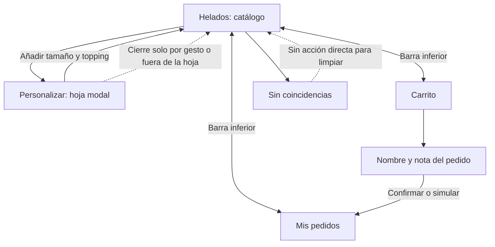
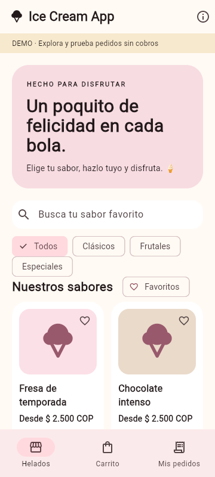
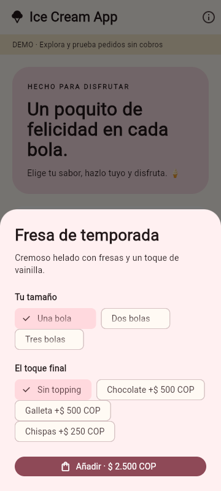

# CP1 · Auditoría de catálogo y personalización

Fuente: ICA Flutter, commit `6d7882d`, `frontend/lib/main.dart` y `store.dart`.
Usuarios: clientes que buscan un sabor y eligen tamaño y topping antes de recogerlo.
Pantallas propuestas para Pablo: catálogo y personalización. La distribución entre
los tres integrantes todavía debe confirmarse. No se evaluó una sesión con usuarios.

## Hallazgos

| Pantalla | Problema observado | Principio | Severidad | Arreglo propuesto |
|---|---|---|---|---|
| Catálogo | Durante la carga solo aparece un indicador circular, sin forma de tarjetas | Visibilidad del estado | Media | Skeleton con nombre, categoría y precio |
| Catálogo | Catálogo sin productos y filtros sin coincidencias muestran el mismo texto | Diagnóstico de errores | Alta | Separar vacío del servidor y cero resultados |
| Catálogo | El vacío pide otra búsqueda pero no ofrece limpiar los filtros | Control del usuario | Media | Botón Restablecer búsqueda |
| Catálogo | El bloque promocional ocupa unos 200 px a 360 px; la acción de la primera tarjeta queda bajo el borde visible | Jerarquía visual | Media | Encabezado breve que priorice sabores y precios |
| Catálogo | Todas las tarjetas usan el mismo pictograma de helado | Reconocimiento | Baja | Priorizar nombre, categoría y descripción; no simular fotografías |
| Catálogo | Los botones de favorito repiten “Añadir a favoritos” sin identificar el sabor en su etiqueta | Accesibilidad | Media | Incluir el nombre del helado en el nombre accesible |
| Catálogo | Cambiar categoría, búsqueda y favoritos no ofrece un resumen del número de coincidencias | Retroalimentación | Media | Mostrar y anunciar el número de sabores |
| Personalización | La hoja modal no tiene un botón explícito de cerrar | Control y navegación | Media | Acción visible Volver al catálogo |
| Personalización | Tamaños y toppings se eligen en grupos visuales; falta una estructura explícita de formulario con etiquetas de grupo | Accesibilidad | Media | Etiquetas y controles nativos asociados para tamaño y topping |
| Personalización | El total solo aparece integrado en el botón de añadir | Jerarquía y retroalimentación | Media | Total identificado y actualizado junto a la selección |

Se conservan las buenas decisiones existentes: navegación de tres secciones,
precios en COP, botón Reintentar, recarga manual y confirmación al añadir al carrito.
Los tamaños táctiles y el contraste se medirán en la versión Ionic; no se asignan
puntajes Lighthouse a Flutter sin ejecutar la herramienta.

## Navegación actual

## Evidencia de la app original a 360 px

La línea base Ionic es el starter sin cambios. Estas capturas corresponden a ICA
Flutter, de donde se toman las entidades y el flujo que se adaptarán al taller.
