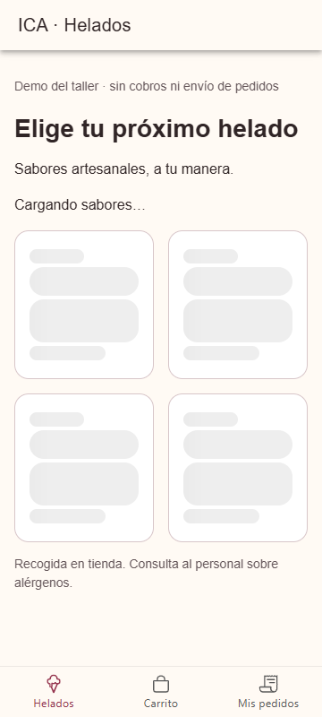
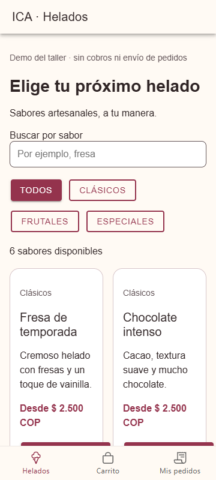
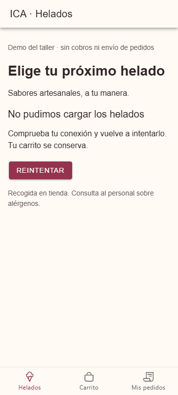
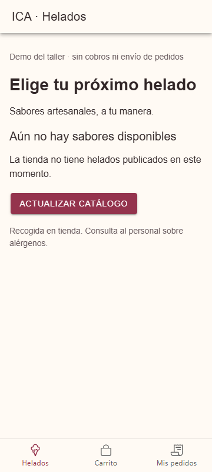

# CP3 · Estados del catálogo de helados

Desde `app`, ejecutar `npm run dev`. Las simulaciones solo están habilitadas en
desarrollo; no alteran el catálogo de ICA ni los datos del servidor.

| Estado | Ruta | Resultado |
|---|---|---|
| Cargando | `/tabs/helados?retraso=10000` | Skeleton de cuatro tarjetas, con categoría, nombre, descripción y precio |
| Con datos | `/tabs/helados` | Seis sabores reales del modo demo de ICA |
| Error recuperable | `/tabs/helados?estado=error` | Falla una vez por recarga del navegador; Reintentar recupera los sabores |
| Catálogo vacío | `/tabs/helados?estado=vacio` | Explicación y botón Actualizar catálogo |
| Sin coincidencias | Buscar `NoExiste` | Mensaje distinto y botón Restablecer búsqueda |

`retraso` se limita a 0–10000 ms. La app conserva el carrito al reintentar.
Sin `VITE_ICA_API_URL` se usan los datos demo. Con esa variable se consulta
`GET /api/products`, con límite de espera de 12 s y validación básica de respuesta.
Los errores de red se presentan al usuario sin detalles técnicos internos.

