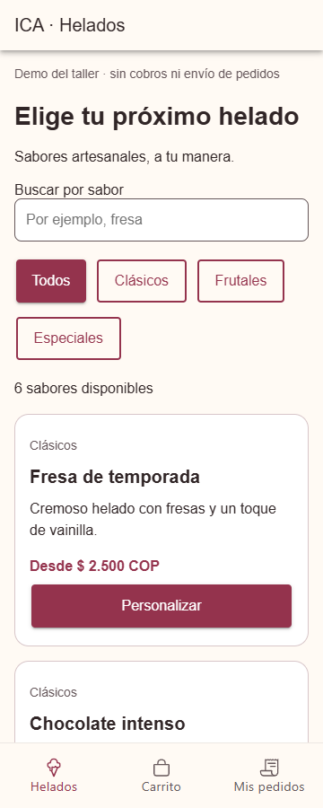
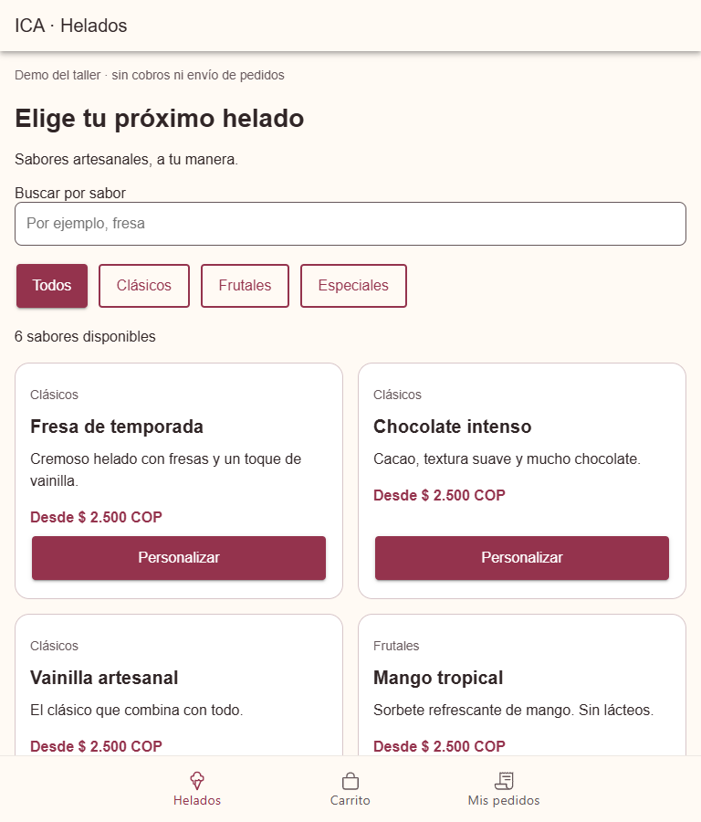
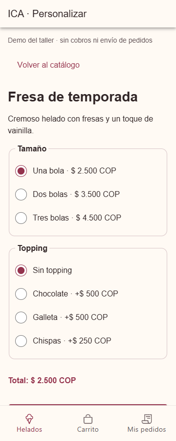
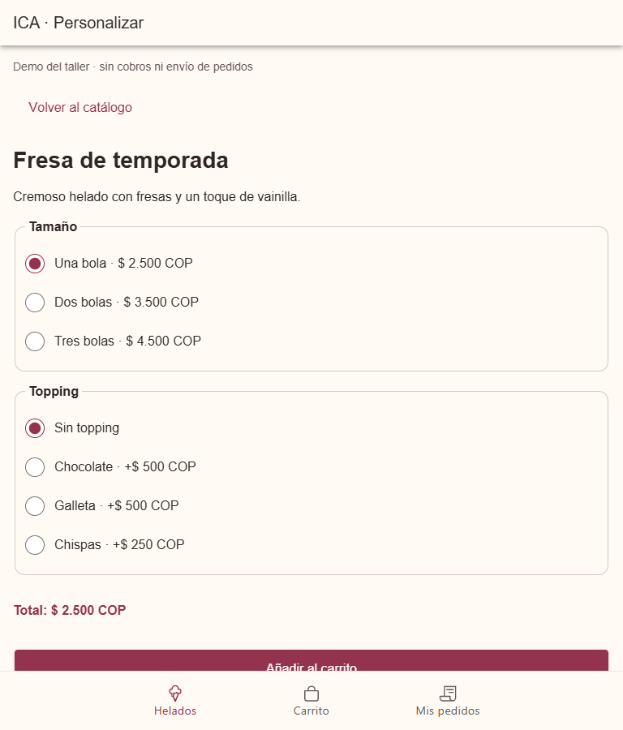

# CP4 · Accesibilidad y diseño responsivo

Se revisaron catálogo y personalización en Chrome con viewports de 360 × 900 y
768 × 900. Se repitió la revisión con tamaño raíz de texto al 200 %. Las capturas
corresponden a la adaptación Ionic, no a la app Flutter original.

## Correcciones

- Se elimina `user-scalable=no` y el límite de zoom del starter.
- Las tarjetas pasan a una columna en móvil y dos en tableta; los textos envuelven.
- Botones y opciones tienen áreas de interacción de al menos 44 × 44 px;
  botones, búsqueda y etiquetas de opciones miden al menos 48 px de alto.
- “Personalizar” incluye el nombre del sabor en su etiqueta accesible.
- Las pestañas tienen texto y nombres accesibles; sus iconos son decorativos.
- Categorías anuncian su selección mediante `aria-pressed`, además del color.
- El número de resultados y el total usan anuncios `aria-live="polite"`.
- Tamaño y topping usan grupos `fieldset`/`legend` y opciones radio con etiquetas.
  Se cambiaron los selectores porque recortaban el texto ampliado.
- Cabecera y pestañas permiten envolver texto. Foco de teclado visible.
- Se conservan mensajes textuales para carga, error y vacío; el color no es el
  único medio de comunicar un estado. No hay fotografías que requieran texto alt.

## Lighthouse: medición real

| Pantalla Ionic | Antes | Después |
|---|---:|---:|
| Catálogo | 94/100 | 100/100 |
| Personalización | 94/100 | 100/100 |

Categoría: Accesibilidad. El fallo inicial fue `meta-viewport` (zoom deshabilitado).
Informes JSON completos en `reports/`, con versión, fecha UTC y auditorías.
Los puntajes automáticos no sustituyen una prueba con lector de pantalla;
esa prueba manual no se ha realizado.

## Verificación de tamaño y flujo

Las mediciones de DOM no detectaron desbordamiento horizontal en el contenido
a 360/768 px ni con texto al 200 %. Se midieron los controles visibles, incluidas
las etiquetas completas que activan las opciones radio. Las páginas se desplazan
verticalmente para alcanzar los botones inferiores.
Se comprobó catálogo → Fresa de temporada → Dos bolas + Chocolate → carrito.
El total fue 4000 COP. También se disparó el evento de `IonRefresher`, se observó
el estado de carga y se verificó la finalización del indicador. El gesto físico
en un teléfono queda pendiente de validación manual.

`npm test`: tres pruebas aprobadas. La prueba de personalización verifica etiquetas
de opciones, selección por radio y cálculo con el precio recibido del servicio.
También se verificó en Chrome la selección con flechas y la acción Añadir con Enter.

## Capturas

| Pantalla | 360 px | 768 px |
|---|---|---|
| Catálogo |  |  |
| Personalización |  |  |

Texto ampliado: [catálogo](img/after-catalogo-360-text200.png) y
[personalización](img/after-personalizacion-360-text200.png).
