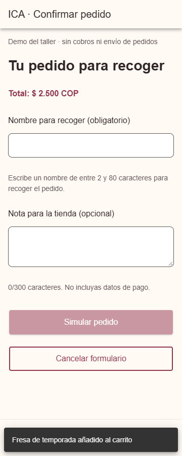
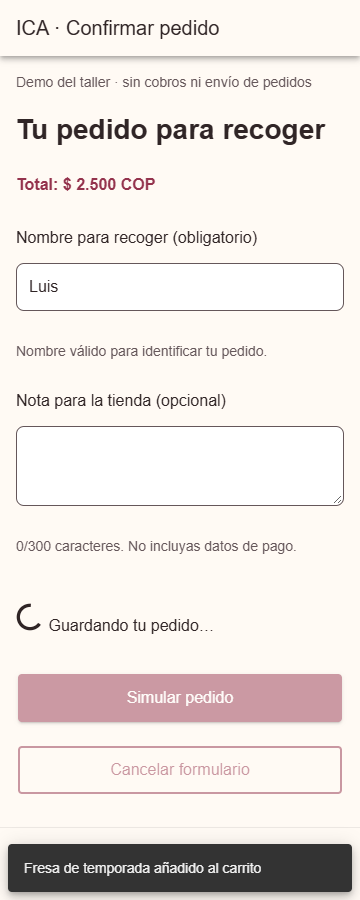
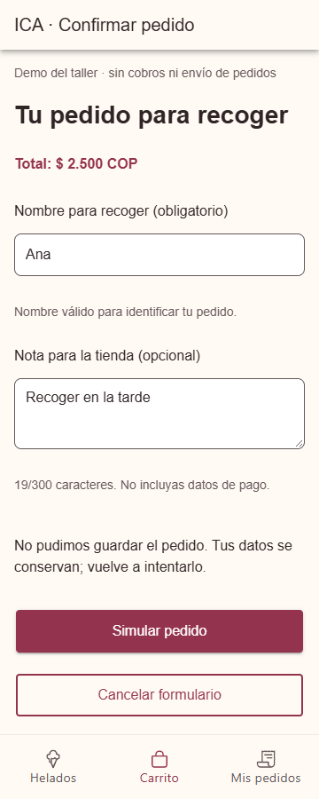
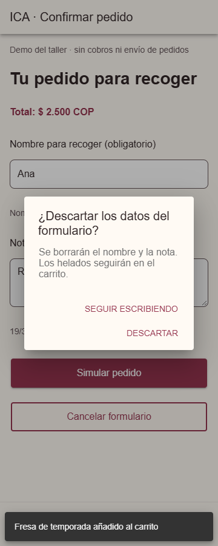
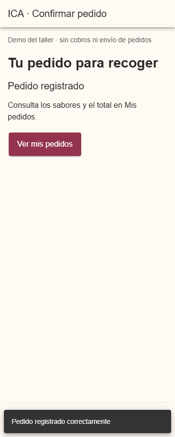
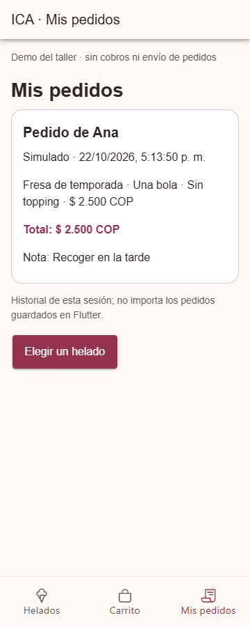

# CP6 · Pedido para recoger

Flujo: catálogo → personalización → carrito → Continuar con el pedido.
El formulario utiliza `customer` y `note` del contrato real de ICA (`backend/src/order.ts`).

| Campo o condición | Regla | Motivo |
|---|---|---|
| Nombre para recoger | Obligatorio, 2–80 caracteres después de quitar espacios exteriores | Identificar a quien recoge el helado |
| Nota | Opcional, hasta 300 caracteres | Instrucciones breves para la tienda |
| Carrito | De 1 a 50 líneas | Coincidir con la validación del servidor |
| Total | COP en pantalla; centavos enteros en `expectedTotal` | Evitar confundir pesos con centavos |

Cada campo tiene mensaje asociado; no se habilita enviar con errores. Durante el envío se bloquean campos y botón, y se muestra `IonSpinner`. `IonToast` anuncia el éxito. Si falla, se conservan nombre, nota y carrito. El reintento mantiene `Idempotency-Key` mientras no cambie el contenido. Descartar el formulario o quitar un helado exige `IonAlert`.
Sin `VITE_ICA_API_URL` el pedido es simulado. Con esa variable se envía `POST /api/orders`; el contrato HTTP se probó con respuesta controlada, no con una tienda real. El historial permanece solo durante esta sesión; recargar la página lo borra.

## Comprobar los estados
Abrir `/tabs/helados?pedido=error`, añadir un sabor y completar el formulario: el primer envío falla y el segundo funciona. Para observar la carga durante cuatro segundos, empezar desde `/tabs/helados?pedido=lento`. Son modos de desarrollo. Abrir sin parámetros para el funcionamiento normal.
`npm test`: 7 pruebas aprobadas, incluidas validación, contrato en centavos, reintento sin duplicado y conservación del nombre tras un error. Se verificaron los controles reales de Ionic en Chrome.

| Validación | Enviando | Error |
|---|---|---|
|  |  |  |
Confirmación: 
Éxito: 
Historial: 
