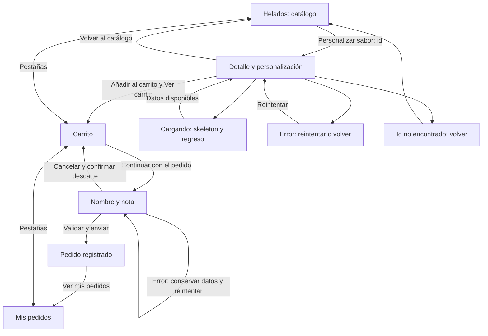
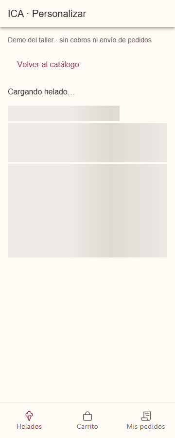
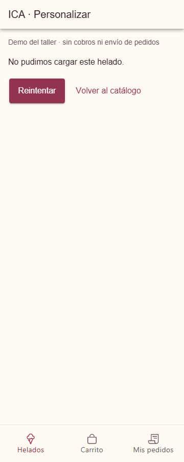
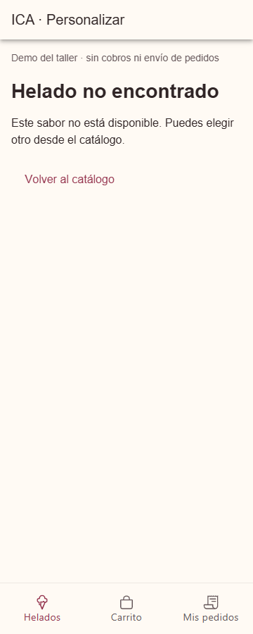
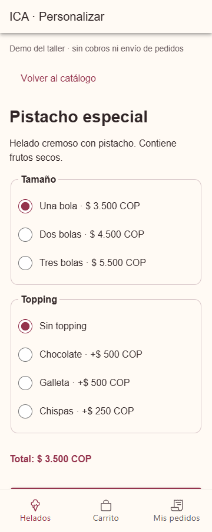
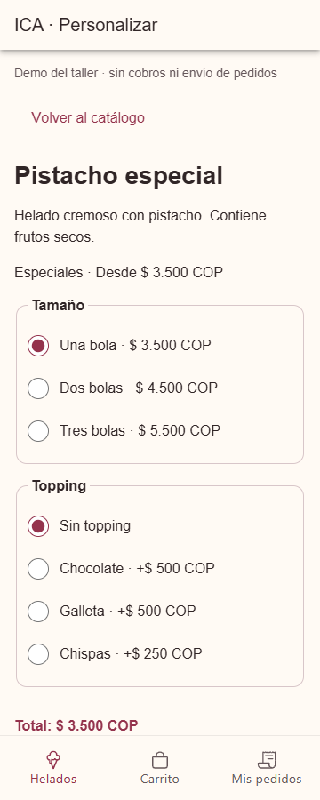

# CP7 · Detalle y recorrido del pedido

Cada tarjeta del catálogo abre `/tabs/helados/:id`. El detalle consulta la misma
fuente de productos, encuentra el identificador y muestra nombre, descripción,
categoría, precio inicial, tamaños, toppings y total. Al cambiar de identificador
se reinician las opciones. No se inventa un endpoint de detalle en el servidor.

## Mapa actualizado

## Comparación con CP1

El mapa original de ICA ya tenía catálogo, personalización, carrito y pedidos.
Se mantiene ese recorrido: no se demuestra una reducción del número de pasos
para comprar. La mejora es un regreso explícito desde el detalle, incluidos los
estados de carga y error, en lugar de depender del gesto para cerrar la hoja.
El detalle tiene URL propia y el formulario lleva a una confirmación con acceso
directo al historial. La barra de Ionic conserva la última pantalla de cada
pestaña; desde personalización se vuelve a la lista con «Volver al catálogo».

## Verificación

`npm test`: 13 pruebas aprobadas en total. Se cubrieron carga pendiente, datos,
reintento, identificadores inexistentes o inválidos y reinicio de opciones.
`npm run lint` y `npm run build` aprobados. La compilación advierte sobre el
tamaño del paquete principal; no impide ejecutarla.

En Chrome se comprobó: catálogo → pistacho → dos bolas y chocolate → carrito →
formulario → confirmación → historial. El total permaneció en 5.000 COP. También
se comprobaron las tres pestañas, el regreso durante la carga y tras un id
ausente, sin errores de JavaScript. El historial no desborda horizontalmente
en 360, 768 y 1280 px. Son comprobaciones técnicas; la prueba con personas es CP8.

Para reproducir estados en desarrollo: `/tabs/helados/6?retraso=5000`,
`/tabs/helados/6?estado=error` y `/tabs/helados/9999`.

| Carga | Error | Identificador inexistente |
|---|---|---|
|  |  |  |

| Detalle antes de CP7 | Detalle después de CP7 |
|---|---|
|  |  |
